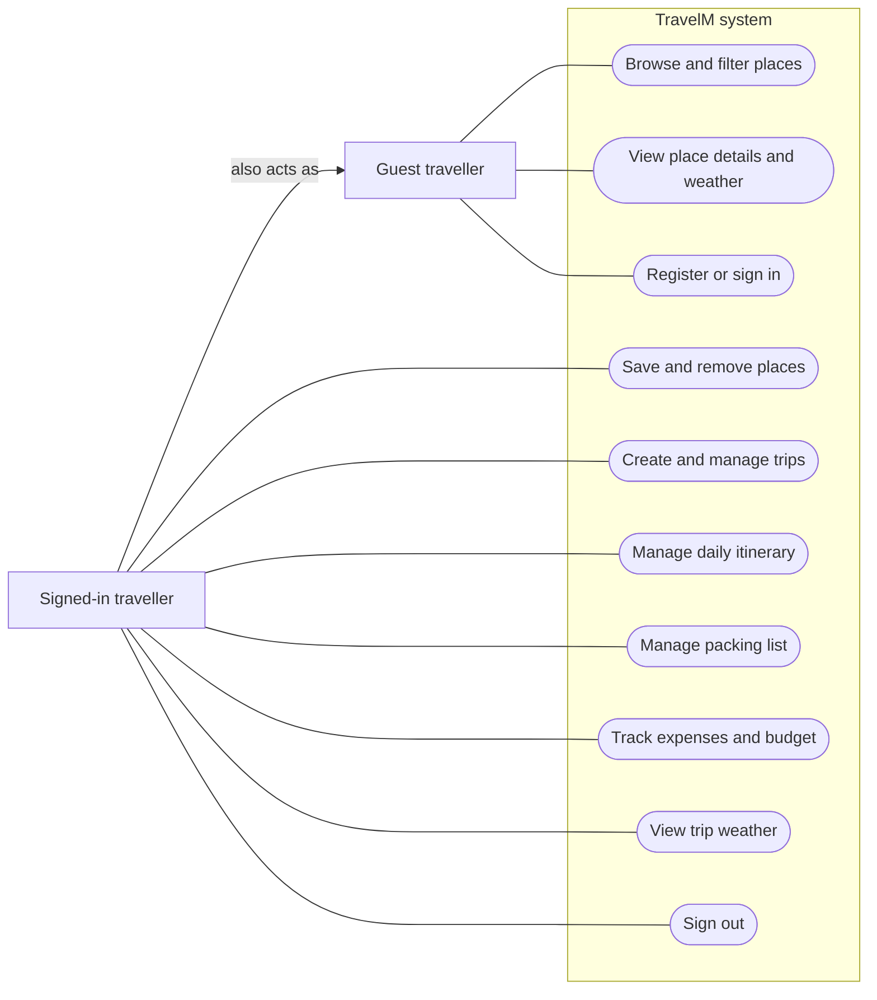
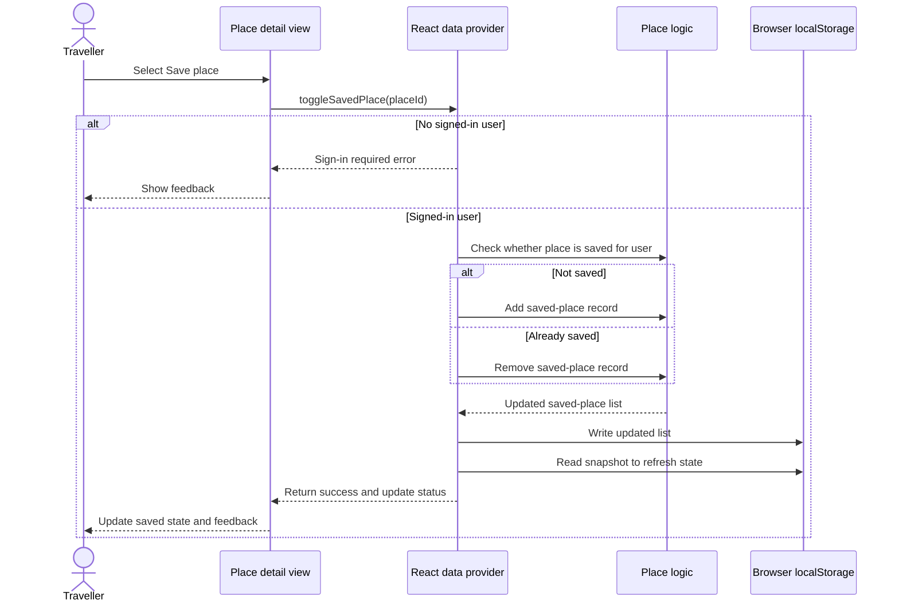
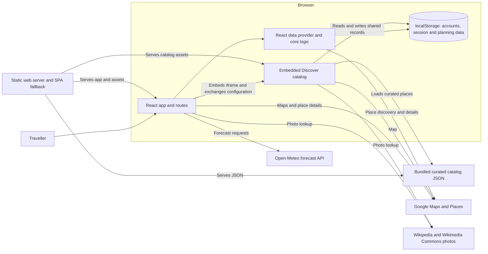

# TravelM system diagrams

These diagrams describe the implementation at commit `c4a6403` (9 November 2026), not a proposed production system. GitHub renders the Mermaid blocks directly. They are a starting point for team review against the course requirements; they do not establish that every requirement or browser flow has passed testing.

## Use case diagram

The system boundary encloses user goals. The traveller can browse without an account; saving and trip planning require a signed-in local account. The signed-in traveller also has the guest's browsing capabilities. Ellipses denote use cases; the arrows show actor associations and inheritance, not a required order of operations.

## Sequence diagram: save a place from its React detail page

This follows the `/discover/:placeId` React detail route, starting after the detail page is open and its data provider has resolved the current session. The embedded Discover catalog has its own save implementation. Saving an already saved place removes it. Browser storage writes can fail, and the current storage helper catches write errors; the success feedback is therefore not proof that a write persisted.

## Architecture diagram

The browser runs the application and holds its accounts and planning data. The server distributes static files and provides the single-page-app route fallback; it is not an application API or account database. External integrations are browser-side and may be unavailable or require configuration.

Local accounts and ownership checks are prototype features, not server-side security. Data is tied to the browser profile and does not automatically sync across devices. Maps, places, photos and weather depend on network access and their respective providers.

## Implementation references

- Routes and access: [`src/App.jsx`](../../src/App.jsx)
- React state and local records: [`src/app/lib/store.jsx`](../../src/app/lib/store.jsx), [`src/core/storage.js`](../../src/core/storage.js), [`src/core/places.js`](../../src/core/places.js)
- React detail save flow: [`src/app/views/PlaceDetail.jsx`](../../src/app/views/PlaceDetail.jsx)
- Embedded catalog: [`src/app/views/Discover.jsx`](../../src/app/views/Discover.jsx), [`public/catalog/catalog-app.mjs`](../../public/catalog/catalog-app.mjs)
- Forecast and hosting: [`src/core/weather.js`](../../src/core/weather.js), [`server/static-server.js`](../../server/static-server.js)
- Course requirements and known limitations: [`docs/COURSE_TRACEABILITY.md`](../COURSE_TRACEABILITY.md)
